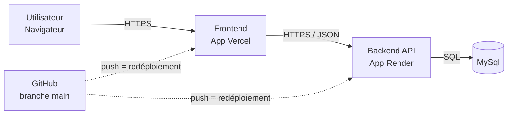

# Gestion de tickets informatiques pour Bonnelatomate

Application web de suivi des demandes informatiques : les collaborateurs peuvent déclarer un incident, consulter les tickets existants et suivre leur résolution.

Projet réalisé dans le cadre du TP **Mise en production & Hébergement** (YNOV, 19 novembre 2026).

> L'objectif du projet n'est pas l'interface, mais la compréhension du chemin qui mène du code source à un service utilisable en production : hébergement, déploiement, variables d'environnement, base de données et CI/CD.

## Liens

| Élément | URL |
|---|---|
| Frontend (Vercel) | `bonnelatomate.vercel.app` |
| API (Render) | `https://projet-hebergement.onrender.com/` |

> Remplacer les valeurs entre chevrons par les URL réelles avant la restitution .

## Architecture

L'application suit une architecture **trois tiers**



| Tiers | Rôle | Technologie | Hébergement |
|---|---|---|---|
| Frontend | Interface utilisateur | Node.js | Vercel |
| Backend | API REST et logique métier | Python | Render |
| Base de données | Stockage persistant | MySql | tidbcloud |
| Code source | Versionnement et déclencheur CI/CD | Git | GitHub |

Le frontend ne communique **jamais** directement avec la base de données : seul le backend y accède. Les identifiants privilégiés de la base restent côté backend.

## Fonctionnalités

- **F1** : afficher la liste des tickets (titre, description, statut)
- **F2** : créer un ticket via un formulaire (titre et description)
- **F3** : faire évoluer le statut d'un ticket : `Ouvert` → `En cours` → `Résolu`
- **F4** : persistance des données après actualisation et redémarrage
- **F5** : application accessible en ligne via des URL publiques en HTTPS

## API

Toutes les réponses sont au format JSON, avec des codes HTTP adaptés.

| Méthode | Route | Fonction | Codes de retour |
|---|---|---|---|
| `GET` | `/health` | Vérifier que l'API répond | `200` |
| `POST` | `/api/auth/register` | Créer un compte utilisateur | `201`, `409`, `422` |
| `POST` | `/api/auth/login` | Se connecter et obtenir un JWT | `200`, `401` |
| `GET` | `/api/auth/me` | Récupérer le compte connecté | `200`, `401` |
| `GET` | `/api/tickets` | Récupérer les tickets | `200` |
| `POST` | `/api/tickets` | Créer un ticket | `201`, `400` |
| `PATCH` | `/api/tickets/:id` | Modifier le statut d'un ticket | `200`, `404`, `422` |
| `DELETE` | `/api/tickets/:id` | Supprimer un ticket (admin uniquement) | `204`, `401`, `403`, `404` |

L'inscription publique crée uniquement des comptes `user`. Les routes tickets nécessitent un jeton `Bearer`; seul un compte `admin` peut supprimer un ticket. Les mots de passe sont hachés côté serveur. Les données reçues sont validées côté API : titre et description non vides, statut limité à `Ouvert`, `En cours` ou `Terminé`. Un nouveau ticket reçoit le statut `Ouvert` et sa date de création automatiquement.

## Modèle de données

```sql
CREATE TABLE tickets (
    id          UUID PRIMARY KEY DEFAULT gen_random_uuid(),
    titre       VARCHAR(255) NOT NULL,
    description TEXT NOT NULL,
    statut      VARCHAR(20) NOT NULL DEFAULT 'Ouvert'
                CHECK (statut IN ('Ouvert', 'En cours', 'Résolu')),
    created_at  TIMESTAMPTZ NOT NULL DEFAULT now()
);
```

La contrainte `CHECK` garantit que le statut reste dans les valeurs autorisées, même en cas d'appel direct à la base.

## Variables d'environnement

Aucun secret n'est versionné dans le dépôt. Render génère `SECRET_KEY`; renseigner également `ADMIN_USERNAME`, `ADMIN_EMAIL` et `ADMIN_PASSWORD` dans les variables du service backend pour créer le compte administrateur initial. Ces valeurs ne doivent pas être ajoutées au dépôt.
