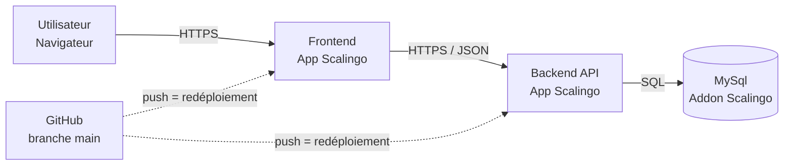

# Gestion de tickets informatiques

Application web de suivi des demandes informatiques : les collaborateurs peuvent déclarer un incident, consulter les tickets existants et suivre leur résolution.

Projet réalisé dans le cadre du TP **Mise en production & Hébergement** (YNOV, 18 et 19 novembre 2026).

> L'objectif du projet n'est pas l'interface, mais la compréhension du chemin qui mène du code source à un service utilisable en production : hébergement, déploiement, variables d'environnement, base de données et CI/CD.

## Liens

| Élément | URL |
|---|---|
| Frontend (Vercel) | `bonnelatomate.vercel.app` |
| API (Scalingo) | `https://bonnelatomate.osc-fr1.scalingo.io/` |

> Remplacer les valeurs entre chevrons par les URL réelles avant la restitution (le domaine exact dépend de la région choisie sur Scalingo).

## Architecture

L'application suit une architecture **trois tiers**, entièrement hébergée sur **Scalingo** (PaaS français). Le code est versionné sur GitHub.



| Tiers | Rôle | Technologie | Hébergement |
|---|---|---|---|
| Frontend | Interface utilisateur | `<à compléter : ex. React + Vite>` | Scalingo (app dédiée) |
| Backend | API REST et logique métier | `<à compléter : ex. Node.js + Express>` | Scalingo (app dédiée) |
| Base de données | Stockage persistant | PostgreSQL | Addon PostgreSQL Scalingo, rattaché à l'app backend |
| Code source | Versionnement et déclencheur CI/CD | Git | GitHub |

Choix d'hébergement : une seule plateforme pour les trois tiers simplifie la gestion des comptes, des variables d'environnement et des logs.

Le frontend ne communique **jamais** directement avec la base de données : seul le backend y accède. L'addon PostgreSQL n'est rattaché qu'à l'application backend, et ses identifiants n'existent que dans les variables d'environnement de cette application.

## Fonctionnalités

- **F1** : afficher la liste des tickets (titre, description, statut)
- **F2** : créer un ticket via un formulaire (titre et description)
- **F3** : faire évoluer le statut d'un ticket : `Ouvert` → `En cours` → `Résolu`
- **F4** : persistance des données après actualisation et redémarrage
- **F5** : application accessible en ligne via des URL publiques en HTTPS

## API

Toutes les réponses sont au format JSON, avec des codes HTTP adaptés.

| Méthode | Route | Fonction | Codes de retour |
|---|---|---|---|
| `GET` | `/health` | Vérifier que l'API répond | `200` |
| `GET` | `/api/tickets` | Récupérer les tickets | `200` |
| `POST` | `/api/tickets` | Créer un ticket | `201`, `400` |
| `PATCH` | `/api/tickets/:id` | Modifier le statut d'un ticket | `200`, `400`, `404` |

Les données reçues sont validées côté API : titre et description non vides, statut limité aux trois valeurs autorisées.

## Modèle de données

```sql
CREATE TABLE tickets (
    id          UUID PRIMARY KEY DEFAULT gen_random_uuid(),
    titre       VARCHAR(255) NOT NULL,
    description TEXT NOT NULL,
    statut      VARCHAR(20) NOT NULL DEFAULT 'Ouvert'
                CHECK (statut IN ('Ouvert', 'En cours', 'Résolu')),
    created_at  TIMESTAMPTZ NOT NULL DEFAULT now()
);
```

La contrainte `CHECK` garantit que le statut reste dans les valeurs autorisées, même en cas d'appel direct à la base.

## Variables d'environnement

Aucun secret n'est versionné dans le dépôt. Un fichier `.env.example` liste les variables attendues ; le fichier `.env` est ignoré par Git.
