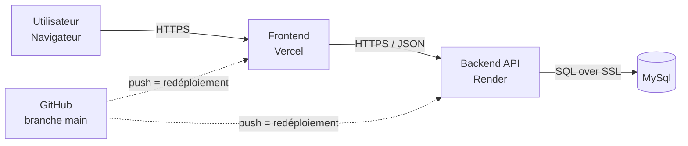

# Gestion de tickets informatiques pour Bonnelatomate

Application web de suivi des demandes informatiques : les collaborateurs peuvent déclarer un incident, consulter les tickets existants et suivre leur résolution.

Projet réalisé dans le cadre du TP **Mise en production & Hébergement** (YNOV, 19 novembre 2026).

> L'objectif du projet n'est pas l'interface, mais la compréhension du chemin qui mène du code source à un service utilisable en production : hébergement, déploiement, variables d'environnement, base de données et CI/CD.

## Liens

| Élément | URL |
|---|---|
| Frontend (Vercel) | `https://projethebergement.vercel.app/` |
| BDD (tidbcloud) | `gateway01.eu-central-1.prod.aws.tidbcloud.comm` |
| Backend (Render) | `https://projet-hebergement.onrender.com/` |
| Dépôt GitHub | `https://github.com/Evanfever13/Projet_Hebergement` |

> Remplacer les valeurs entre chevrons par les URL réelles avant la restitution.

## Équipe

| Membre | Contribution |
|---|---|
| Evan Sedda | Documentation |
| Hugo Paulier | Développement |
| Geoffroy Huart | Production |


## Architecture

L'application suit une architecture **trois tiers**.



| Tiers | Rôle | Technologie | Hébergement |
|---|---|---|---|
| Frontend | Interface utilisateur | Node.js | Vercel |
| Backend | API REST et logique métier | Python | Render |
| Base de données | Stockage persistant | MySql | tidbcloud |
| Code source | Versionnement et déclencheur CI/CD | Git | GitHub |

Le frontend ne communique **jamais** directement avec la base de données : seul le backend y accède. Les identifiants privilégiés de la base restent côté backend.

## Fonctionnalités

- **F1** : afficher la liste des tickets (titre, description, statut)
- **F2** : créer un ticket via un formulaire (titre et description)
- **F3** : faire évoluer le statut d'un ticket : `Ouvert` → `En cours` → `Résolu`
- **F4** : persistance des données après actualisation et redémarrage
- **F5** : application accessible en ligne via des URL publiques en HTTPS

## API

Toutes les réponses sont au format JSON, avec des codes HTTP adaptés.

| Méthode | Route | Fonction | Codes de retour |
|---|---|---|---|
| `GET` | `/health` | Vérifier que l'API répond | `200` |
| `GET` | `/api/tickets` | Récupérer les tickets | `200` |
| `POST` | `/api/tickets` | Créer un ticket | `201`, `400` |
| `PATCH` | `/api/tickets/:id` | Modifier le statut d'un ticket | `200`, `400`, `404` |

Exemple de création :

```bash
curl -X POST https://projet-hebergement.onrender.com/api/tickets \
  -H "Content-Type: application/json" \
  -d '{"titre": "Imprimante en panne", "description": "Étage 2, bureau 204"}'
```

Exemple de changement de statut :

```bash
curl -X PATCH https://projet-hebergement.onrender.com/api/tickets/<id> \
  -H "Content-Type: application/json" \
  -d '{"statut": "En cours"}'
```

Les données reçues sont validées côté API : titre et description non vides, statut limité aux trois valeurs autorisées.

## Modèle de données

```sql
CREATE TABLE tickets (
    id          UUID PRIMARY KEY DEFAULT gen_random_uuid(),
    titre       VARCHAR(255) NOT NULL,
    description TEXT NOT NULL,
    statut      VARCHAR(20) NOT NULL DEFAULT 'Ouvert'
                CHECK (statut IN ('Ouvert', 'En cours', 'Résolu')),
    created_at  TIMESTAMPTZ NOT NULL DEFAULT now()
);
```

La contrainte `CHECK` garantit que le statut reste dans les valeurs autorisées, même en cas d'appel direct à la base.

## Variables d'environnement

Aucun secret n'est versionné dans le dépôt. Un fichier `.env.example` liste les variables attendues ; le fichier `.env` est ignoré par Git.

## Lancer le projet en local

Prérequis : Node.js (version LTS) et un accès à une base PostgreSQL (Supabase ou instance locale).

```bash
# 1. Cloner le dépôt
git clone https://github.com/<organisation>/<depot>.git
cd <depot>

# 2. Backend
cd backend
cp .env.example .env        # puis renseigner DATABASE_URL et FRONTEND_URL
npm install
npm run dev                 # API disponible sur http://localhost:3000

# 3. Frontend (dans un autre terminal)
cd frontend
cp .env.example .env        # puis renseigner l'URL de l'API locale
npm install
npm run dev                 # interface disponible sur http://localhost:5173
```

> Adapter les commandes, dossiers et ports à la structure réelle du dépôt.

## Déploiement

Les étapes ci-dessous décrivent l'ordre suivi. Aucun secret n'est à renseigner dans le dépôt : tout passe par les variables d'environnement des plateformes.

### 1. Base de données (Tidbcloud)

1. Créer un projet Tidbcloud.
2. Exécuter le script SQL du modèle de données pour créer la table `tickets`.
3. Récupérer la chaîne de connexion adaptée à un backend hébergé (connexion poolée si Render ne supporte pas l'IPv6).

### 2. Backend (Render)

1. Créer un **Web Service** sur Render et connecter le dépôt GitHub.
2. Renseigner le répertoire racine (`backend`), la commande de build (`npm install`) et la commande de démarrage (`npm start`).
3. Définir les variables d'environnement (`DATABASE_URL`, `FRONTEND_URL`).
4. Déployer, consulter les logs, puis tester `GET /health` et `GET /api/tickets`.

### 3. Frontend (Vercel)

1. Importer le dépôt GitHub dans un nouveau projet Vercel.
2. Indiquer le répertoire racine (`frontend`) et vérifier le framework détecté.
3. Définir la variable `VITE_API_URL` avec l'URL publique de l'API Render.
4. Déployer et vérifier que la liste des tickets s'affiche.

